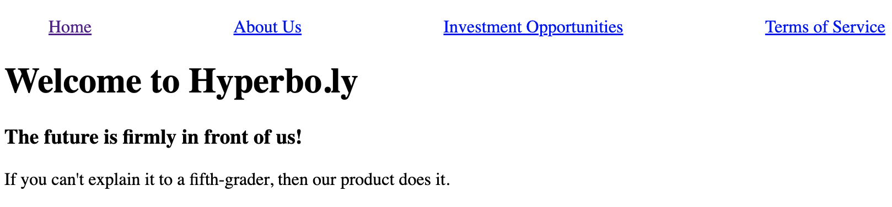

# 

**Learning objective:** By the end of this lesson, students will be able to modularize a react application across multiple components.

## Modularize Components

In this lesson, we'll explore modularizing components as we build the landing page for Hyperbo.ly, a super-hot tech start-up making unbelievable progress in every field you can name: AI, VR, Crypto, NFTs...if it's confusing and exciting, it's Hyperbo.ly!

### Navbar Modularization

When considering where to split up pieces of a front-end application into separate components, you should think about where the lines would be drawn on a wireframe sketch of the site. It's also helpful to think about which pieces might be reusable across different pages. One particular UI piece that is on nearly every web page comes to mind when considering both requirements: navigation bars!

Navbars are a perfect use case for our first modularized component: reusable and generally isolated from the rest of the site. They usually are kept at the top of the page, and there are specific interactions we can assume a navbar would have. Let's look at some React code where we have nested a `<nav>` JSX element and some default navbar items. 

```jsx
// scr/App.jsx

const App = () => {
    return (
        <>
            <nav id="top-navbar">
                <ul>
                    <li>
                        <a href="/">Home</a>
                    </li>
                    <li>
                        <a href="/about-us">About Us</a>
                    </li>
                    <li>
                        <a href="/money-pit">Investment Opportunities</a>
                    </li>
                    <li>
                        <a href="/the-fine-print">Legal Disclosures</a>
                    </li>
                </ul>
            </nav>
            <main>
                <h1>Welcome to Hyperbo.ly</h1>
                <h3>The future is firmly in front of us!</h3>
                <p>If you can't explain it to a fifth-grader, then our product does it.</p>
            </main>
        </>
    )
}
```

Additionally, let's delete the contents of `index.css` and add some styling to our navbar:

```css
/* src/index.css */

#top-navbar ul {
    display: flex;
    list-style-type: none;
    justify-content: space-between;
}
```

You should see the following in your browser when you run the app:



### Splitting the Navbar

The code we want to split off is bundled up nicely inside the single `<nav>` element. This makes modularizing it into a separate component a quick operation.

Create a new `Navbar.jsx` file for this component. It should be created in the `src` folder of the project as a sibling to `App.jsx`

```bash
touch src/Navbar.jsx
```

We'll create a React component inside this file and export it from `Navbar.jsx`. Once this is done we can import it into `App.jsx`, as well as any other future components that require a navbar at the top. It may seem odd to capitalize the names of these files since they're written in camelCase-loving JavaScript, but the React convention is to capitalize our components' file and function names. 

Remember, React components are essentially just functions that return HTML, so let's start with a function:

```jsx
// src/Navbar.jsx

const Navbar = () => {
}
```

So far, a function that returns nothing. Fortunately, what we want to return is the big `<nav>` element from the `App.jsx` file, so we can cut-and-paste the entirety of the `<nav>` element as the return value for `Navbar`:

```jsx
// src/Navbar.jsx

const Navbar = () => {
    return (
        <nav id="top-navbar">
            <ul>
                <li>
                    <a href="/">Home</a>
                </li>
                <li>
                    <a href="/about-us">About Us</a>
                </li>
                <li>
                    <a href="/money-pit">Investment Opportunities</a>
                </li>
                <li>
                    <a href="/the-fine-print">Legal Disclosures</a>
                </li>
            </ul>
        </nav>
    )
}
```

The last piece of the puzzle for modularizing components is the critical `export` statement, which allows components to be pulled into other components with an `import` statement.

Add the following to the bottom of our `Navbar.jsx` file:

```jsx
// src/Navbar.jsx

export default Navbar;
```

### Importing the Navbar into the App

Now that we've created a Navbar component, let's import it into our `App.jsx` file. Add the following statement to the top of our `App.jsx` file:

```jsx
// src/App.jsx

import Navbar from './Navbar.jsx'
```

To include the `Navbar` component in `App.jsx` we use the same HTML syntax as with any other element - in this case, `<Navbar></Navbar>`. React components rarely need any content between their opening and closing tags, so they will typically use the self-closing tag shortcut: `<Navbar/>`

Right above the `<h1>` where the nav element used to be, we can now add the component back in:

```jsx
// src/App.jsx

const App = () => {
  return (
    <>
      <Navbar />
      <main>
        <h1>Welcome to Hyperbo.ly</h1>
        <h3>The future is firmly in front of us!</h3>
        <p>If you can't explain it to a fifth-grader, then our product does it.</p>
      </main>
    </>
  )
}
```

Nice and tidy! Check back in the browser, and you should see the site restored to its original look, only now with 100% more components working together to make it happen. 

## Component-Specific CSS. Kind of.

While you'll learn more sophisticated methods of creating component-specific CSS styles later in your react journey, we should create a separate .css file for each component. After all, components should be treated as a separate project, including the styling necessary to complete them. So, they should get their own .css file. 

Move the navbar's CSS code from App.css into a new file called `Navbar.css`, created as a sibling file to `Navbar.jsx` at the root level.

Now, add an import statement to the top of your `Navbar.jsx` file that imports the `Navbar.css` style sheet:

```jsx
// src/Navbar.jsx

import './Navbar.css'
```

You might think this means the style will only be applied within the Navbar component. While that would be amazing (and there are tools to create actual, component-specific CSS), sadly, the styles will be applied globally to any page the Navbar component shows up on. So, you should still write your rules specific to the scope of the component, such as using an id, as in our example Navbar component's style.
