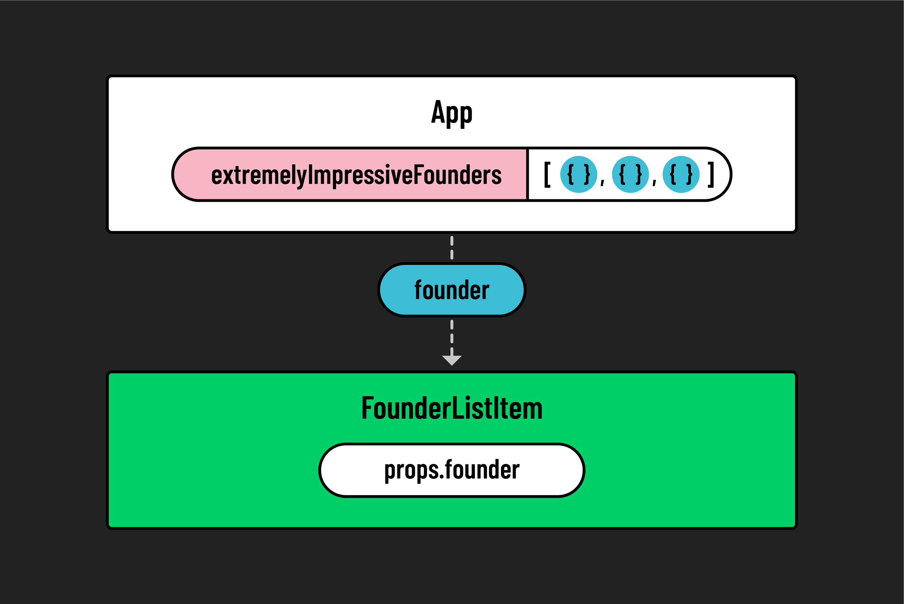

# 

**Learning objective:** By the end of this lesson, students will be able to use props in React to pass data between different components.

## Reusability in React

So far, our Navbar component takes advantage of the **modularization** of React components. The other significant impact of React components is their **reusability**, so let's look at reusing a single component to represent all the items in a list.

Think about the standard dashboard page, which is an indexed list of things on most web applications. Each item in the list _could_ be its own React component, but that would mean creating a new, unique file for every element in the list. This wouldn't even be possible if the list was dynamically created based on user data!

Instead, we want to create a single reusable React component that is built to display one item in a list. Given an array of objects we want to display, we need some way of passing a single object to each instance of the reusable list item component.


Enter `props`.

We mentioned earlier that every React component is essentially a JavaScript function that returns HTML. When we write JS functions, we often have some kind of argument passed into the function. So far, our React components have not been designed to accept any input - until now!

React components can pass data down to child components as `props`. One of React's core features is how data only flows downwards from a parent to a child component. This design pattern is technically referred to as **unidirectional data flow**. In React, the child component cannot define or change the props of its parent, and the child is not even allowed to change the props it is given by its parent. In other words, `props` are **immutable**. 


There are two pieces of the puzzle to cover: setting up a component to accept props from its parent, and setting up the parent to send props down to its children.

## Creating the Child Component

To convince investors to fund our incredible, mind-blowing AI crypto VR/AR startup, let's have the home page display a list of the fantastic founding team putting this thing together. The App.jsx component will loop over an array of objects to generate this list, with each object being passed down as props to a child component.

First, let's set up our child component by creating a file named `FounderListItem.jsx` with (for now) some small, testable filler code. No need to worry about props yet. Let's just get the multiple components flowing and go from there.

```jsx
// src/FounderListItem.jsx

const FounderListItem = () => {
    return (
        <li> 
            <h3>Hello, I'm a super impressive Founder too!</h3>
        </li>
    )
}
```

Remember to export it!

```jsx
// src/FounderListItem.jsx

export default FounderListItem
```

Now that we have the child component stubbed out let's add an array of data to our App component and map through it, returning an instance of `<FounderListItem>` for each object in the array:

In `App.jsx`, add the following data:

```jsx
// src/App.jsx

const extremelyImpressiveFounders = [
    {
        name: "Elizabeth Holmes",
        title: "CEO",
        credential: "MBA from SuperLegit U"
    },
    {
        name: "Sam Bankman-Fried",
        title: "CFO",
        credential: "CPA from TotallyReal State"
    },
    {
        name: "Matt Damon",
        title: "CMO",
        credential: "Was in that Movie You saw"
    },
];
```

### 🎓 You Do: Map Over the Founders, Without Props

In the return statement of `App.jsx`, inside a `<ul>`, use a `.map()` statement to loop over the `extremelyImpressiveFounders` array and return a `<FounderListItem>` for each founder object.

## Sending Data to the Child



To pass `props` to a child component, we use the same syntax as HTML attributes. We define key-value pairs in the element like so:

```jsx
// src/App.jsx

<FounderListItem founder={founder} />
```

Within the resulting `props` object, the lefthand `founder` will be the key, while the value passed into the curly braces will be the value.

## Using Props in the Child

Now that data is being passed down to the `FounderListItem` component, we can refactor that function to accept a new parameter named `props`:

```jsx
// src/FounderListItem.jsx

const FounderListItem = (props) => {
    // Component content remains unchanged
}
```

Whenever we want to access a property passed down from the parent, we can use the `props` object. In our app, `props` will have a `founder` property, since that's what we named the attribute inside of `App.jsx`. We can update our `FounderListItem` component to display the data given to it:

```jsx
// src/FounderListItem.jsx

const FounderListItem = (props) => {
    return (
        <li>
            <h3>{props.founder.name}: {props.founder.title}</h3>
            <p>{props.founder.credential}</p>
        </li>
    );
}
```

## Destructuring Props

Depending on how nested the data gets, it can get tedious to keep typing and reading the word `props` in front of everything, such as `props.founder.name` and `props.founder.credential`. As a result, many React developers will **destructure** the props object in their components. This means that the component can use object destructuring syntax when defining its parameters, which looks like this: 

```jsx
// src/FounderListItem.jsx

const FounderListItem = ({ founder }) => {
    return (
        <li>
            <h3>{founder.name}: {founder.title}</h3>
            <p>{founder.credential}</p>
        </li>
    );
}
```

This doesn't require changing the parent component's syntax, so it's purely a matter of preference within the child component. 

### 🎓 You Do: Refactor the Navbar List

While the items in the navbar are unlikely to change and are typically okay to hard-code, let's use the opportunity to practice this pattern of refactoring lists into separate components. The goal is to refactor the list of links in the Navbar to use the same mapping pattern as our list of founders.

Add the following array to `Navbar.jsx` and use it to map over and return a child component for each item in the list. This will involve creating a new `NavbarListItem.jsx` component to accept and display props from the `Navbar.jsx` parent component.

```js
// src/Navbar.jsx

const pagesInTheApp = [
    {
        name: 'Home',
        href: '/'
    },
    {
        name: 'About Us',
        href: '/about-us'
    },
    {
        name: 'Investment Opportunities',
        href: '/money-pit'
    },
    {
        name: 'Legal Disclosures',
        href: '/the-fine-print'
    },
];
```

## When Do Components Go Too Far?

Was it necessary to refactor the static navbar list items into their components? Probably not! Just because you can make something into its own component doesn't mean you should. If repeated elements are based on dynamic, user-generated data, they should be separate components that accept props. If those elements are just static links, as in the Navbar example, they likely don't need separate components. 

However, you'll find professional developer teams creating component libraries that do precisely this sort of thing: every button in the app is a separate component that carries its own props, styling, and functionality with it. This keeps things consistent no matter how large the app becomes. Suppose every developer uses the team's custom `<ResponsiveButton>` component instead of generic `<button>` elements. In that case, the team can benefit from modularized React components. When joining a React dev team, you should expect to inherit a custom component library that the team uses throughout the application.