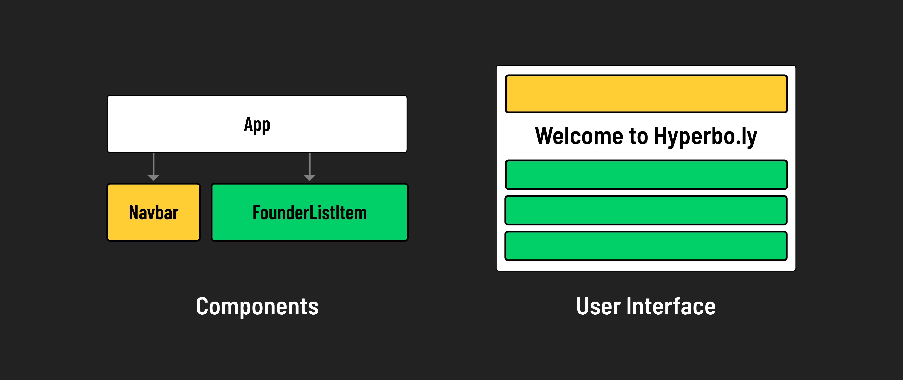
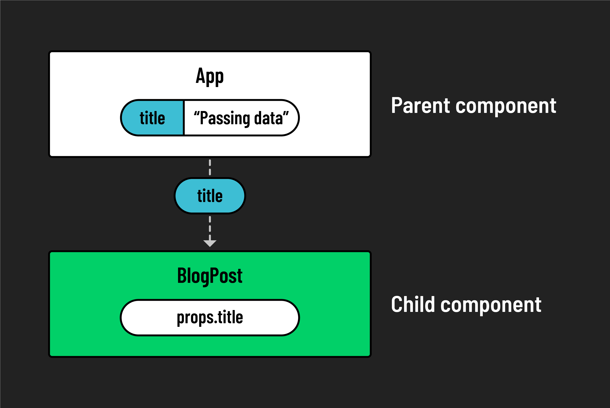

# 

**Learning objective:** By the end of this lesson, learners will be able to understand and implement the concept of passing data between components in React using `props`.

## Reusability in React

Our `Navbar` component has already showcased the **modularity** of React components. But there’s another impressive feature in React’s toolkit: **reusability**. Let’s explore how we can reuse a single component for multiple items in a list.

First, we need to add the rest of our sample markup to our `App` component:

```jsx
// scr/App.jsx

const App = () => {
  return (
    <>
      <Navbar />
      <main>
        <h1>Welcome to Hyperbo.ly</h1>
        <h2>The future is firmly in front of us!</h2>
        <p>
          If you can't explain it to a fifth-grader, then our product does it.
        </p>
      </main>
      <h2>Our Founders</h2>
      <ul>
        <li>
          <h3>Elizabeth Holmes: CEO</h3>
          <p>MBA from SuperLegit University</p>
        </li>
        <li>
          <h3>Sam Bankman-Fried: CFO</h3>
          <p>CPA from TotallyReal State</p>
        </li>
        <li>
          <h3>Matt Damon: CMO</h3>
          <p>Was in that Movie You saw</p>
        </li>
      </ul>
    </>
  );
};
```

### Remember the `<ul>` of founders?

It presents a series of items - in this case, the founders - each with an name and description. You might consider turning each founder's details into a separate React component, but imagine the hassle of creating a distinct file for each founder, especially when the list might change or expand.

A more efficient approach is to create a single, flexible React component that can represent any founder in the list. Picture it as a template that shapes itself according to the data it receives. For example, this component would take the information of each founder (like the name, title, and credential) and render it appropriately. We need a method to pass the specific details of each founder, perhaps as an object, to this versatile component, allowing it to dynamically render the founder's information.



## Enter `props`

We mentioned earlier that every React component is essentially a JavaScript function that returns HTML. When writing JS functions, its common to pass in data as an argument. So far, our React components have not been written to accept any input - until now!

React's architecture allows data to flow from parent components to child components using **`props`**.

- This is key for passing data around in your application, reinforcing React's tree-like structure. Think of it as a one-way street where data travels downwards from a parent to a child component, a concept central to React known as **_unidirectional data flow_**.

Another important feature is that `props` are **_immutable_**.

- This means that a child component cannot change the props it receives from its parent, nor can it alter the props of its parent or sibling components. `Props` are like read-only instructions sent down from parent to child, ensuring a stable and predictable flow of data.

To see this in action, consider our web page example. Imagine if we want to pass information about each founder from our main `App` component to a `FounderListItem` component. We would use `props` to send each founder's details down the component tree.

So, in our case, each `FounderListItem` would receive its own set of props (like name, title, and credential) from the `App` component but couldn't modify this data. It can only use the props to render the founder's details as specified.


To create this structure in our existing application, there are two pieces of the puzzle to solve: setting up a component to accept props from its parent, and setting up the parent to send props down to its children.

## Creating the child component

To convince investors to fund our incredible, mind-blowing AI crypto VR/AR startup, let's have the home page display a list of the fantastic founding team putting this thing together.

First, let's set up our child component by creating a file named `FounderListItem.jsx` with some small, testable placeholder code. No need to worry about `props` yet. Let's just get our components rendered to the page.

```jsx
// src/FounderListItem.jsx

const FounderListItem = () => {
  return (
    <li>
      <h3>Hello, I'm a super impressive Founder!</h3>
    </li>
  );
};
```

Remember to export it!

```jsx
// src/FounderListItem.jsx

export default FounderListItem;
```

### Render our components in `App.jsx`

Import `FounderListItem` at the top of App.jsx and replace the list items in the JSX with the new component.

```jsx
// scr/App.jsx

import FounderListItem from "./FounderListItem.jsx";
import Navbar from "./Navbar.jsx";

const App = () => {
  return (
    <>
      <Navbar />
      <main>
        <h1>Welcome to Hyperbo.ly</h1>
        <h2>The future is firmly in front of us!</h2>
        <p>
          If you can't explain it to a fifth-grader, then our product does it.
        </p>
      </main>
      <h2>Our Founders</h2>
      <ul>
        <FounderListItem />
        <FounderListItem />
        <FounderListItem />
      </ul>
    </>
  );
};
```

Notice how modular our `App` component markup is starting to look!

Now that we have the child components stubbed out, let's add an array of founder data to our `App` component and start passing real props to our `FounderListItem` components.

 Add the following data at the top of In `App.jsx`, just below the import statements:

```jsx
// src/App.jsx

const extremelyImpressiveFounders = [
  {
    name: "Elizabeth Holmes",
    title: "CEO",
    credential: "MBA from SuperLegit University",
  },
  {
    name: "Sam Bankman-Fried",
    title: "CFO",
    credential: "CPA from TotallyReal State",
  },
  {
    name: "Matt Damon",
    title: "CMO",
    credential: "Was in that Movie You saw",
  },
];
```

We will use this array to dynamically pass data to each of our child components soon, but first we must prepare the child components to receive `props`. 

## Passing `props`to a child component

`Props` are passed to child components by adding them as named attributes to the component elements in the JSX.

```jsx
<FounderListItem name="Elizabeth Holmes" title="CEO" credential="MBA from SuperLegit University" />
```

> Here we are passing three `props` as strings by the variables: `name`, `title` and `credential`.

However `props` are not limited to strings, and can also take the form of objects or arrays.

```jsx
<FounderListItem founder={{name: "Elizabeth Holmes", title: "CEO", credential: "BA from SuperLegit University"}} />
```

> Here we are passing a single `prop` as an object named `founder`.

## Reading `props` inside child components

React components are just functions, so once a `prop` has been passed to a component in JSX, it's like passing an argument that can be used inside the component file.

```jsx
const FounderListItem = ({name, title, credential}) => {
  return (
    <li>
      <h3>
        {name}: {title}
      </h3>
      <p>{credential}</p>
    </li>
  );
};
```

### 🎓 You Do Passing `props`

Take a moment and refactor your `FounderListItem` component to receive `props`. Then practice passing some to the component via `App`.


> Don't be confused by the curly braces `{ }` inside the function `()` parentheses above. This is not React, this is Javascript **destructuring**. React components actually only take one argument by default, an object called "props". By using destructuring syntax, we avoid the more verbose syntax of directly accessing each property of the props object in our component.
>
> ```jsx
> const FounderListItem = (props) => {
>   return (
>     <li>
>       <h3>
>         {props.name}: {props.title}
>       </h3>
>       <p>{props.credential}</p>
>     </li>
>   );
> };
> ```
>
> Destructuring keeps the code in our components more readable and is the more modern syntax convention for handling `props`.

<!--  -->
[tktk hunter a graphic with the connection between the component and the function]()

## Dynamically rendering components with props

We have three founders to list on our site, so passing individual `props` values does not allow us to programmatically render the data from our `extremelyImpressiveFounders` array. For this, we'll need to create a loop in our JSX to dynamically render data from our list.

Let's refactor `App.jsx` to include a mapped list of `FounderListItem` components:

```jsx
// src/App.jsx

const App = () => {
  return (
    <>
      <Navbar />
      <main>
        <h1>Welcome to Hyperbo.ly</h1>
        <h2>The future is firmly in front of us!</h2>
        <p>
          If you can't explain it to a fifth-grader, then our product does it.
        </p>
      </main>
      <h2>Our Founders</h2>
      <ul>
        {extremelyImpressiveFounders.map((founder, index) => (
          <FounderListItem
            key={index}
            name={founder.name}
            title={founder.title}
            credential={founder.credential}
          />
        ))}
      </ul>
    </>
  );
};
```

> Reminder: When we use the `.map()` method in React to create a list of components, like our `FounderListItem` components, it's essential to give each one a unique `key` prop. This `key` helps React keep track of each item in the list. Specifically, it's used for identifying which items have changed, been added, or been removed. This is crucial for performance, especially when dealing with dynamic lists that might get updated or reordered.

We should now see our founders rendered to the page dynamically from our array. Great work! 

## Consolidating our `props`

Currently, there are only three properties listed for each object of the `extremelyImpressiveFounders` array- `name`, `title` and `credential`. We are passing these down individually as `props` to each `FounderListItem` component. Three is a manageable number, but imagine if there were 20 or more, how does this scale?

Our list of `props` passed to `FounderListItem` would soon become unmanageably large in our JSX.

```jsx
<FounderListItem
  key={index}
  name={founder.name}
  title={founder.title}
  credential={founder.credential}
  // probably many more!
/>
```

Let's refactor our `.map()` function one more time for a more scalable `prop` structure:

```jsx
// src/App.jsx

<ul>
  {extremelyImpressiveFounders.map((founder, index) => (
    <FounderListItem key={index} founder={founder} />
  ))}
</ul>
```

This requires one more change to the `FounderListItem` component:

```jsx
// src/FounderListItem.jsx

const FounderListItem = ({ founder }) => {
  return (
    <li>
      <h3>
        {founder.name} : {founder.title}
      </h3>
      <p>{founder.credential}</p>
    </li>
  );
};
```

Much better! 


## 🚀 Level Up: JS spread syntax

If you want to avoid refactoring `FounderListItem` and prefer not having to access properties as `founder.something`, Javascript has one more tool to simplify passing multiple `props` as a bundle - the spread operator  `...`.

The spread operator `...` in JavaScript is a convenient way to pass ***all the properties*** of an object as `props` to a React component.


```jsx
const App = () => {
  return (
    <>
      <Navbar />
      <main>
        <h1>Welcome to Hyperbo.ly</h1>
        <h2>The future is firmly in front of us!</h2>
        <p>
          If you can't explain it to a fifth-grader, then our product does it.
        </p>
      </main>
      <h2>Our Founders</h2>
      <ul>
        {extremelyImpressiveFounders.map((founder, index) => (
          <FounderListItem key={index} {...founder} />
        ))}
      </ul>
    </>
  );
};
```

In the `App` component, when you use the spread operator for `{...founder}`, what you're doing is essentially taking each key-value pair from the founder object and passing them as separate props to the `FounderListItem` component.
 
When used with a component like `FounderListItem`, it allows us to maintain a clean and concise syntax while still being able to individually access each property within the component.

```jsx
const FounderListItem = ({name, title, credential}) => {
  return (
    <li>
      <h3>
        {name}: {title}
      </h3>
      <p>{credential}</p>
    </li>
  );
};
```

In the `FounderListItem` component, you are able to define concise parameters like `{name, title, credential}`. These directly correspond to the keys in the founder object. By using object destructuring, you're able to extract each of these properties from the `props` object.